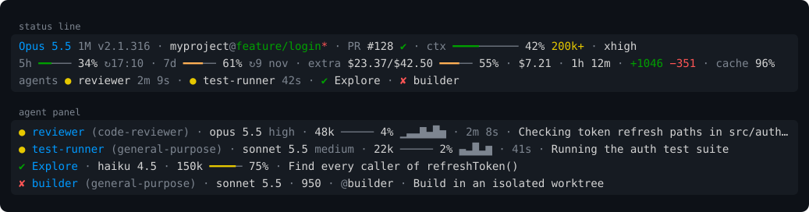

# claude-pulse

[](https://github.com/moictab/claude-pulse/actions/workflows/ci.yml)
[](LICENSE)

A clean, information-dense status line for [Claude Code](https://code.claude.com/docs/en/overview): model, git, context, rate limits, cost and your running subagents, at a glance.



- **Everything in three lines.** Line 1 is the session, line 2 is limits and cost, and line 3 is your subagents, shown only while there are any.
- **Subagents always in view.** See which subagents are running, finished or failed without opening the agent panel. The panel rows get model, context, activity and elapsed time.
- **Quiet by design.** It follows the look of Claude Code's own footer, with no emoji. Color only marks something worth noticing.
- **Fast and local.** Two Bash scripts that read Claude Code's JSON with `jq`, and never block on the network. Nothing leaves your machine except one optional request, which you can turn off ([details](#privacy)).
- **Works everywhere Claude Code does:** macOS, Linux and Windows (Git Bash), tested in CI on each.

## Quick start

**1. Install [`jq`](https://jqlang.org/download/)** (1.6 or later), if you don't have it:

| OS | Command |
|----|---------|
| macOS | `brew install jq` |
| Debian / Ubuntu | `sudo apt install jq` |
| Fedora | `sudo dnf install jq` |
| Windows | `winget install jqlang.jq` |

**2. Download the two scripts** into your Claude config directory:

```bash
mkdir -p ~/.claude
curl -fsSL -o ~/.claude/statusline.sh https://raw.githubusercontent.com/moictab/claude-pulse/main/statusline.sh
curl -fsSL -o ~/.claude/subagent-statusline.sh https://raw.githubusercontent.com/moictab/claude-pulse/main/subagent-statusline.sh
chmod +x ~/.claude/statusline.sh ~/.claude/subagent-statusline.sh
```

**3. Add them to `~/.claude/settings.json`** (merge these keys into what is already there):

```json
{
  "statusLine": {
    "type": "command",
    "command": "bash ~/.claude/statusline.sh",
    "refreshInterval": 5
  },
  "subagentStatusLine": {
    "type": "command",
    "command": "bash ~/.claude/subagent-statusline.sh"
  }
}
```

That's it: the status line appears on Claude Code's next update. To check the install, run `bash ~/.claude/statusline.sh --version`.

On Windows, Claude Code runs these commands with Git Bash, which comes with [Git for Windows](https://gitforwindows.org/).

## What it shows

The model and context are always shown. Every other segment appears only when Claude Code sends its data, so the lines stay short when there is nothing to report.

### Line 1: session

| Segment | Example | Description |
|---------|---------|-------------|
| **Model** | `Opus 5.5 1M v2.1.316` | Current model, `1M` on 1M-token context windows, and the Claude Code version |
| **Directory and branch** | `myproject@main*` | Working directory and git branch, with a red `*` for uncommitted or untracked changes |
| **Worktree** | `worktree my-feature` | Worktree name when the session runs in a git worktree |
| **Pull request** | `PR #128 ✔` | Open PR for the branch (`MR !42` for GitLab), clickable in terminals that support links, with its review state: green ✔ approved, yellow ● pending, red ✘ changes requested, `draft` |
| **Context** | `ctx ━━━━────── 42% 200k+` | Context window usage, plus a yellow `200k+` once the session crosses the 200k-token pricing tier |
| **Thinking** | `no thinking` | Only shown when extended thinking is off |
| **Effort** | `xhigh` | Reasoning effort, on models that support it |
| **Output style** | `style Explanatory` | Active output style (hidden when `default`) |
| **Fast mode** | `fast` | Shown while fast mode is on |
| **Agent** | `agent reviewer` | Agent name when Claude Code runs with `--agent` |

### Line 2: limits and cost

| Segment | Example | Description |
|---------|---------|-------------|
| **5h limit** | `5h ━━─── 34% ↻17:10` | 5-hour rate limit and the local time it resets (Pro and Max plans) |
| **7d limit** | `7d ━━━── 61% ↻9 nov` | 7-day rate limit and the date it resets (Pro and Max plans) |
| **Spend limit** | `spend $314.12/$500.00 ━━━── 63% ↻13 nov` | Spend and limit, behind a Claude apps gateway |
| **Extra usage** | `extra $23.37/$42.50 ━━━── 55%` | Extra usage credits spent vs. monthly limit, if enabled on your account ([see Privacy](#privacy)) |
| **Session cost** | `$7.21 · 1h 12m · +1046 −351` | Estimated session cost, session duration and lines added/removed |
| **Prompt cache** | `cache 96%` | Session cache hit ratio, with a yellow `cold` once the cache has expired |

Bars fill with `━` in green, then orange from 50%, yellow from 70% and red from 90%; the empty part `─` stays dim.

### Line 3: subagents

`agents ● reviewer 2m 9s · ● test-runner 42s · ✔ Explore · ✘ builder`

While the agent panel lists subagents, this line shows each one's state and name, and how long the running ones have been working: yellow ● running, green ✔ done, red ✘ failed, dim ⊘ stopped. If it doesn't fit the terminal width, it drops the times first, then switches to counts (`agents ● 2 running · ✔ 3 done`). It disappears about 15 seconds after the panel empties.

Claude Code only sends subagent data to the `subagentStatusLine` command, so this line needs both scripts installed. `subagent-statusline.sh` saves the panel rows to a cache file (about every 5 seconds), and `statusline.sh` reads it. That's also why `refreshInterval` is recommended: without it, the status line only updates on events like a new message, and goes quiet while Claude waits for subagents.

### Agent panel rows

`subagent-statusline.sh` also replaces each row of the agent panel below the prompt:

| Part | Example | Description |
|------|---------|-------------|
| **Status** | `●` | Yellow ● running, green ✔ completed, red ✘ failed, ⊘ stopped |
| **Name** | `reviewer (code-reviewer)` | Subagent name and its type (`Explore`, `Plan` or a custom agent) |
| **Model** | `opus 5.5 high` | Short model name and effort |
| **Tokens** | `48k ───── 4%` | Token count and context usage |
| **Activity** | `▁▃▃▇▄█▅` | Tokens added per refresh, while running |
| **Elapsed** | `2m 8s` | Time since it started, while running |
| **Directory** | `@builder` | Shown when the subagent works in its own directory, such as an isolated worktree |
| **Task** | `Checking token refresh…` | Progress summary, cut to fit the panel |

In a narrow panel, rows drop the activity, directory, model and elapsed time, in that order, to stay on one line.

## Managing subagents

claude-pulse displays subagents but can't control them: Claude Code offers no way for an external script to stop or message one. Use Claude Code's own controls:

| Where | Action |
|-------|--------|
| Agent panel | `↑` / `↓` to select a row, `Enter` to open its transcript and send it follow-up messages, `x` to stop it (or dismiss a finished row), `Esc` to go back to the prompt |
| `/tasks` | View and manage background work in the session, including subagents that have finished |
| `Ctrl+B` | Send running subagents and Bash commands to the background |
| `Ctrl+X Ctrl+K` | Stop all running background subagents (press twice within 3 seconds to confirm) |

To cap how many subagents run at once, set the `CLAUDE_CODE_MAX_CONCURRENT_SUBAGENTS` environment variable (default 20). To block a subagent type, use a permission rule such as `"deny": ["Agent(Explore)"]`. See the [subagents documentation](https://code.claude.com/docs/en/sub-agents).

## Configuration

### Status line settings

| Setting | Description |
|---------|-------------|
| `refreshInterval` | Re-run the status line every N seconds, on top of event-driven updates. `5` matches the agent panel's refresh rate; larger values use less CPU but update the agents line less often. |
| `padding` | Extra horizontal spacing, in characters. |

### Environment variables

Set them in the `command` itself, for example `"command": "CLAUDE_PULSE_EXTRA_USAGE=0 bash ~/.claude/statusline.sh"`.

| Variable | Default | Description |
|----------|---------|-------------|
| `CLAUDE_PULSE_EXTRA_USAGE` | `1` | `0` turns off the extra usage segment: no token lookup and no network request |
| `CLAUDE_PULSE_CACHE_DIR` | `${TMPDIR:-/tmp}/claude` | Where the scripts keep their cache. If you change it, set it for both commands. |
| `CLAUDE_CODE_OAUTH_TOKEN` | | OAuth token to use for the extra usage request, instead of looking one up |

### Colors

The scripts use 24-bit (truecolor) ANSI colors, defined at the top of `statusline.sh`:

```bash
blue=$'\033[38;2;0;153;255m'    # model
green=$'\033[38;2;0;160;0m'     # branch, lines added, approved PR, bars under 50%
orange=$'\033[38;2;255;176;85m' # bars from 50%
yellow=$'\033[38;2;230;200;0m'  # warnings (200k+, fast, no thinking, cold cache), pending PR, bars from 70%
red=$'\033[38;2;255;85;85m'     # dirty marker, lines removed, changes requested, bars from 90%
dim=$'\033[2m'                  # labels, separators, reset times
```

`jq` programs can't read shell variables, so the agents line (at the end of `statusline.sh`) and the panel rows (`subagent-statusline.sh`) define the same colors as `def green: ...;` functions. Change them there too. Your changes are overwritten when you update.

## Privacy

Everything is computed locally from the JSON Claude Code passes to the scripts, plus `git` and your `~/.claude/settings.json` (read only to check whether thinking is turned off).

The one exception is the **extra usage** segment, because Claude Code doesn't provide that data. To show it, `statusline.sh` looks up your Claude Code OAuth token and sends it to `https://api.anthropic.com/api/oauth/usage`, at most once a minute, in the background. The token is never sent anywhere else. It looks for the token in, in order:

1. the `CLAUDE_CODE_OAUTH_TOKEN` environment variable
2. the macOS Keychain
3. `~/.claude/.credentials.json` (Linux and Windows)
4. the GNOME Keyring

That endpoint is undocumented and may change or stop working without notice. Set `CLAUDE_PULSE_EXTRA_USAGE=0` to turn the segment off: the scripts then make no network requests and never read your token.

The scripts write only to the cache directory (`${TMPDIR:-/tmp}/claude` by default): the extra-usage response (`statusline-usage-cache.json`) and one `subagents-<session id>.json` file per session for the agents line. Session files older than a day are deleted automatically.

## Troubleshooting

**The status line says `claude-pulse: jq not found`.** Install `jq` (see [Quick start](#quick-start)), then restart Claude Code so it picks up the new `PATH`.

**Nothing shows up, or only `Claude`.** Test the script by hand:

```bash
echo '{"model":{"display_name":"Opus"},"context_window":{"used_percentage":12}}' | bash ~/.claude/statusline.sh
```

If that prints a status line, check that `~/.claude/settings.json` is valid JSON and that `disableAllHooks` isn't set, since it also turns off status lines.

**The agents line never appears.** It needs both `statusLine` and `subagentStatusLine` configured, and they must use the same `CLAUDE_PULSE_CACHE_DIR`. Without `refreshInterval`, it only updates when Claude Code redraws the status line.

**Symbols show up as boxes.** Use a terminal font with box-drawing characters and common Unicode symbols, such as JetBrains Mono, Cascadia Code, SF Mono or Menlo.

**Reset times are in the wrong timezone.** They use the system timezone; set `TZ` in the command (`"command": "TZ=Europe/Madrid bash ~/.claude/statusline.sh"`).

**No extra usage segment.** It needs a Pro or Max plan with extra usage enabled, `curl`, and a Claude account login (not an API key). It is fetched in the background, so it shows up on the status line update after the first one.

Still stuck? [Open an issue](https://github.com/moictab/claude-pulse/issues/new/choose).

## Updating and uninstalling

**Update:** run the `curl` commands from [Quick start](#quick-start) again. See what changed in the [changelog](CHANGELOG.md).

**Uninstall:** remove the `statusLine` and `subagentStatusLine` keys from `~/.claude/settings.json`, then delete the scripts and their cache:

```bash
rm ~/.claude/statusline.sh ~/.claude/subagent-statusline.sh
rm -f "${TMPDIR:-/tmp}/claude/statusline-usage-cache.json" "${TMPDIR:-/tmp}"/claude/subagents-*.json
```

## Compatibility

- **Claude Code:** any version with status lines. Segments for newer fields, such as the prompt cache (v2.1.251+) or subagent types (v2.1.293+), simply don't appear on older versions.
- **Systems:** macOS, Linux and Windows with Git Bash.
- **Tools:** bash 3.2+, jq 1.6+. `git` and `curl` are optional.

CI runs the test suite on Ubuntu 22.04, 24.04 and 26.04 (GNU and Rust coreutils), macOS (system bash 3.2) and Windows (Git Bash).

## Contributing

Bug reports, ideas and pull requests are welcome. See [CONTRIBUTING.md](CONTRIBUTING.md) for how to run the tests.

## License

[MIT](LICENSE). claude-pulse is an independent project, not affiliated with or endorsed by Anthropic.
